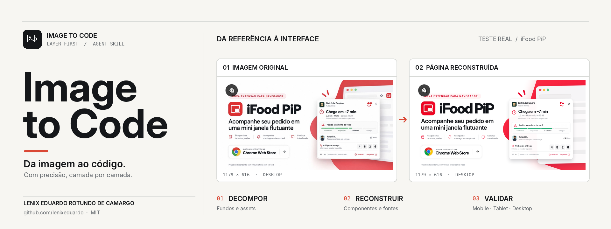

# Image to Code — Layer First

<picture>
  <source media="(max-width: 640px)" srcset="assets/cover-mobile.png">
  
</picture>

**Criado por Lenix Eduardo Rotundo de Camargo** · GitHub: [@lenixeduardo](https://github.com/lenixeduardo) · Licença: MIT

Uma **Agent Skill** para converter prints, mockups e imagens de referência em interfaces reais, mantendo a identidade visual. Ela desmonta a imagem em camadas e documenta cada parte antes de gerar os componentes do frontend.

> A skill precisa de um agente com capacidade de compreender imagens, acesso ao projeto e ferramentas de edição. Os scripts incluídos não são uma IA de visão e não conseguem recuperar conteúdo oculto por trás de outros elementos.

## Novo: proteção contra regressões da Catty (v1.4.0)

A skill agora exige três revisões: **agente de fidelidade da interface** (ícones, fonte carregada e tamanho do botão), **agente de integridade de assets** (originais aprovados, brilhos integrados à ilustração, borrões e pata visível) e **revisor independente de homologação**. Quando não houver ferramenta de subagentes, executar três análises separadas e declarar essa limitação.

O novo `scripts/audit_fidelity_contract.py` bloqueia divergências de regiões críticas, diferenças geométricas e arquivos originais ausentes ou alterados (SHA-256). O exemplo `examples/catty-analysis-2.contract.example.json` traz **coordenadas fictícias**; é obrigatório substituí-las por medidas reais, assim como registrar os hashes dos assets aprovados. Leia o [protocolo de auditoria independente](references/fidelity-gates.md). Esses testes melhoram a skill; não representam correções já aplicadas ao aplicativo Catty.

## Novo: recriação de imagem guiada por referência (v1.5.0 — fluxo do vídeo)

Quando o usuário pedir para **recriar** a imagem, a skill não poderá usar um recorte como asset final. Ela deverá primeiro analisar a imagem inteira e recortar o componente **somente para usar como referência do gerador**. O agente escreverá um prompt descritivo fiel, anexará **imagem original + recorte + prompt** à ferramenta de geração e produzirá **a cena inteira sem textos ou elementos de interface**. A iluminação já faz parte da cena. Depois, numa segunda etapa, restaurará os textos, fontes e posições: **HTML/CSS real** para webpages e edição sobre a imagem apenas para poster estático solicitado.

O fluxo reprova patas cortadas, identidade modificada, acessórios inventados, borrões, brilho duplicado e palavras ilegíveis. Documenta as tentativas e bloqueia aprovação sem evidências. Ver [procedimento completo](references/reference-guided-regeneration.md), [prompt Catty](examples/catty-hero-scene-prompt.md) e [validador](scripts/validate_generation_cycle.py). Um prompt não garante reprodução 100% idêntica; a comparação visual é obrigatória. Sem ferramenta de geração, a skill informa a limitação e não troca geração por recorte.

## O que a skill faz

1. **Background:** identifica cor, gradiente, textura, máscara, posição e comportamento de cada fundo e decide se deve recriar em CSS ou exportar uma imagem.
2. **Estrutura e componentes:** mede grids, margens, largura máxima, botões, cards, menu, hero, seções e comportamento de cada elemento.
3. **Tipografia:** documenta a família de fonte quando confirmável ou marca como estimativa; define pesos, espaçamentos, line-height e tamanho de títulos e textos em cada breakpoint.
4. **Ícones e assets:** conserva arquivos originais, recorta regiões reaproveitáveis, recupera transparência quando possível e usa SVG para formas que possam ser reconstruídas corretamente.
5. **Imagens:** mantém o enquadramento e a proporção, especifica `object-fit`, ponto focal, formatos e variantes.
6. **Responsividade:** especifica layout mobile, tablet e desktop, incluindo navegação, ordem de leitura, número de colunas e ajustes de imagem/tipografia.
7. **Código:** implementa no framework já existente no projeto, sem redesenhos desnecessários.
8. **Validação visual:** captura a implementação no navegador, gera overlay/diff, identifica divergências e realiza correções até atingir o objetivo ou documentar limitações.
9. **Apresentação obrigatória:** exibe no próprio chat **mobile + tablet lado a lado** e, quando a entrada for um screenshot de interface desktop, **original + reconstrução desktop lado a lado**.

## Arquivos de entrega exigidos

- `artifacts/design-spec.json`: especificação completa validada pelo schema.
- `artifacts/asset-manifest.json`: imagens/ícones/fundos gerados, extraídos, originais ou pendentes.
- `artifacts/assumptions.md`: informações observadas, inferidas e desconhecidas.
- `artifacts/screenshots/mobile.png`, `tablet.png`, `desktop.png`: evidências do navegador.
- `artifacts/presentation/mobile-tablet-side-by-side.png`: prancha obrigatória visível diretamente no chat.
- `artifacts/presentation/desktop-original-vs-render.png`: comparação desktop lado a lado quando a referência é desktop; senão `desktop-preview.png`.
- `artifacts/presentation/presentation-report.json`: classificação da referência, tamanhos, recortes e avisos de incompatibilidade.
- `artifacts/audit/...`: sobreposição e diferenças, além de relatório.
- Código funcional no projeto de destino, com componentes reutilizáveis.

## Instalação em Claude Code, Freebuff, Hermes, OpenCode e outros agentes

**Um único pacote, sem versões diferentes para cada agente.** O instalador copia o `SKILL.md` com seus scripts, referências e assets para o diretório correto. Funciona em Linux, macOS e Windows (Python 3.10+).

| Agente | Diretório por projeto |
| --- | --- |
| Claude Code | `.claude/skills/image-to-code/` |
| OpenCode | `.opencode/skills/image-to-code/` |
| Freebuff / Codebuff | `.agents/skills/image-to-code/` |
| Hermes Agent | `.hermes/skills/image-to-code/` |
| Codex | `.agents/skills/image-to-code/` |
| Cursor | `.cursor/skills/image-to-code/` |
| Gemini CLI | `.gemini/skills/image-to-code/` |
| Outros (Agent Skills) | `.agents/skills/image-to-code/`, se suportado |

```bash
git clone https://github.com/lenixeduardo/image-to-code.git
cd image-to-code

# Instalar em todos os agentes dentro de um projeto já existente
python scripts/install.py --agent all --scope project --project /caminho/meu-site

# Exemplo: Claude Code + OpenCode + Freebuff + Hermes, globalmente
python scripts/install.py --agent claude,opencode,freebuff,hermes --scope global

# Simular, validar, atualizar com backup
python scripts/install.py --agent all --project /caminho/meu-site --dry-run
python scripts/install.py --agent all --project /caminho/meu-site --verify
python scripts/install.py --agent all --project /caminho/meu-site --force
```

No Windows, pode usar `py -3` no lugar de `python`. `--scope global` instala no perfil do usuário. `--force` preserva o diretório anterior como backup; nada é sobrescrito silenciosamente. A instalação de Freebuff, Codex e outros agentes compatíveis com `.agents/skills/` é compartilhada, sem criar três cópias. **Hermes exige `hermes skills trust` dentro do projeto para carregar skills locais.** O código da skill não inclui modelos de visão: o agente escolhido precisa receber a imagem e ter ferramentas para editar os arquivos.

Veja [compatibilidade completa e comandos por agente](references/agent-compatibility.md).

## Exemplo de comando para o agente

```text
$image-to-code

Reconstrua a imagem anexada dentro do projeto atual.
Execute a análise em camadas, começando pelo background.
Identifique cada asset e componente, sua posição e tamanho.
Registre famílias de fontes, pesos, tamanhos, line-height e espaçamento.
Preserve imagens, ícones e logotipos originais.
Implemente a página em mobile, tablet e desktop.
Capture screenshots reais, compare com as referências e corrija divergências.
Entregue o design-spec.json, asset-manifest.json e evidências da auditoria.
Exiba no chat a prancha mobile + tablet lado a lado e, para um print desktop,
a prancha referência original + reconstrução desktop lado a lado.
Nunca apresente suposições como medidas exatas.
```

## Ferramentas opcionais

```bash
python -m pip install -r requirements.txt
python scripts/image_inventory.py input/referencia.png --out artifacts/inventory.json
python scripts/export_layers.py input/referencia.png --regions examples/regions.example.json --out artifacts/assets
python scripts/validate_spec.py artifacts/design-spec.json
```

Para capturas em navegador:

```bash
npm install
npx playwright install chromium
node scripts/capture.mjs --url http://localhost:3000 --out artifacts/screenshots
```

Para comparar o layout com uma referência do mesmo tamanho:

```bash
python scripts/audit_visual.py --reference input/referencia.png --render artifacts/screenshots/desktop.png --out artifacts/audit/desktop
```

Gere as duas pranchas obrigatórias de apresentação (não substituem a auditoria pixel a pixel):

```bash
python scripts/present_results.py \
  --mobile artifacts/screenshots/mobile.png \
  --tablet artifacts/screenshots/tablet.png \
  --desktop artifacts/screenshots/desktop.png \
  --reference input/referencia-desktop.png \
  --desktop-reference-render artifacts/screenshots/desktop-mesmo-viewport.png \
  --reference-kind desktop \
  --out artifacts/presentation
```

Exiba as duas imagens resultantes **no corpo da conversa**, sem depender de download, e nunca misture mobile, tablet, desktop e assets numa prancha gigante. Para referência não desktop, a segunda prancha é uma prévia desktop individual. Se houver recorte intencional da referência, declare `--reference-crop X Y W H`.

**Resoluções padrão de captura:** mobile 390×844, tablet 820×1180, desktop 1440×900. O agente também deve verificar 360, 430, 768, 1024, 1280 e 1920 pixels de largura.

## Limitações técnicas

- Fonte exata, imagem encoberta e layout de outros dispositivos não podem ser determinados com certeza a partir de um único print.
- Extrações de screenshot podem manter parte do fundo e demandar tratamento manual ou uma ferramenta de segmentação.
- Capturas em outros breakpoints servem para verificar a responsividade, mas não demonstram fidelidade a uma referência que não existe.
- Ativos protegidos por terceiros precisam de origem e licença adequadas.
- A meta de nota 9,5/10 depende de implementação, execução, revisão visual e evidências; não é uma promessa de resultado automático.

Consulte [README.md](README.md) para a documentação completa em inglês e [SKILL.md](SKILL.md) para as regras executadas pelo agente.

## Autoria e créditos

**Criador e autor da skill:** Lenix Eduardo Rotundo de Camargo ([@lenixeduardo](https://github.com/lenixeduardo)).

Os créditos de autoria não implicam propriedade sobre imagens, fontes, marcas ou outros materiais de terceiros usados como referência nos projetos reconstruídos. Consulte [AUTHORS.md](AUTHORS.md) e [LICENSE](LICENSE).

Documento detalhado: [Padrão de demonstração](references/presentation-standard.md).

## Controles de qualidade — v1.1.0

- A captura verifica imagens ausentes, erros JavaScript, elementos interativos sem nome acessível, ausência de marco principal e overflow horizontal.
- Captura em viewport correspondente à referência: `node scripts/capture.mjs --url http://localhost:3000 --reference-viewport 1179x616 --smoke-widths 360,430,768,1024,1280,1920`. A opção `--allow-warnings` serve apenas para diagnóstico, não para homologação.
- Na homologação, usar `--require-matching-desktop` em `present_results.py` para impedir comparação de tamanhos diferentes.
- Regiões mascaradas agora aparecem sinalizadas nas imagens de auditoria e ficam excluídas também dos arquivos de diferença.
- Executar `python -m unittest discover -s tests -v` e `node --test tests/test_capture.mjs`. Testes dos scripts não comprovam fidelidade pixel-perfect sem referência e navegador real.
- Se o ambiente bloquear o navegador ou a navegação, registrar a limitação, sem inventar capturas ou aprovações.


## Asset consistency for existing websites / Integridade de assets

Run `python scripts/audit_project_assets.py --project /path/to/project --out artifacts/project-assets.json` to detect references to missing images before and after generation. A fallback image rendering successfully does **not** establish that the original asset was recovered. Dynamic imports or remote assets require manual inspection.


## Revisão visual obrigatória

Os quatro revisores de qualidade (ícones, tipografia/botões, anatomia dos personagens, iluminação já presente no asset) estão descritos em [`references/visual-review-agents.md`](references/visual-review-agents.md). Antes de declarar fidelidade, gere evidências e valide `artifacts/visual-review.json` com `python scripts/validate_visual_review.py --file artifacts/visual-review.json --root .`. Renderizar sem erros não prova fidelidade.


## Validação pixel-perfect por estado — v1.6.0

A homologação da Catty mostrou um falso positivo: os textos e a navegação estavam corretos, mas o celular e os controles inferiores ficaram cortados. A skill agora exige **captura e comparação de cada tela** e uma verificação de geometria no navegador.

```bash
python -m pip install -r requirements-pixel-perfect.txt
python scripts/calibrate_pixel_perfect.py --reference mockup-triptych.png --columns 3 \
  --render artifacts/tela-1.png --render artifacts/tela-2.png \
  --render artifacts/tela-3.png --normalize-reference --out artifacts/pixel-qa
node scripts/validate_visual_states.mjs examples/visual-states.example.json
```

São geradas comparações original × HTML/CSS por tela, mapas de diferenças, SSIM (opcional), erro médio RGB e relatório. O navegador reprova elementos obrigatórios cortados, escondidos por containers ou fora da viewport. O redimensionamento da referência é **explícito**, não automático. SSIM não é nota de 0 a 10, e partes ocultas de assets só podem ser recuperadas exatamente com os originais.

Consulte [procedimento técnico](references/pixel-perfect-qa.md) e [TODOs priorizados](TODO.md). Mockups privados ficam fora do repositório público.
